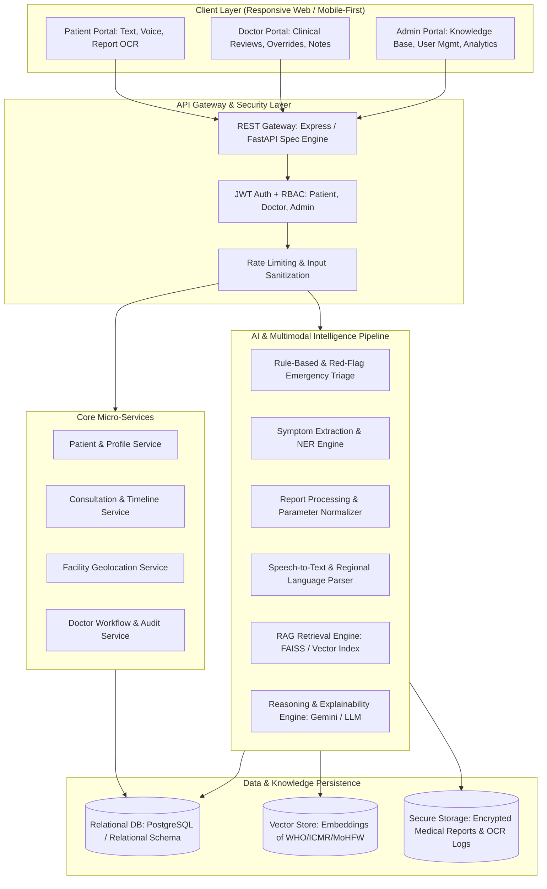
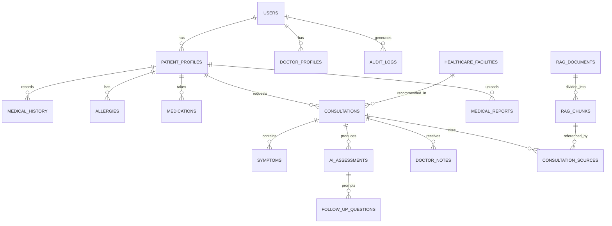
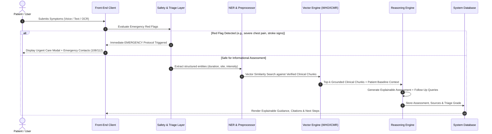

# RuralCare AI — System Architecture & Engineering Specification
### AI-Based Personalized Rural Healthcare Decision Support Platform
**Academic Project Specification — B.E. Information Technology Final Year Capstone**

---

## 1. Executive Summary & Problem Statement

In rural and underserved regions, healthcare access is constrained by:
1. **Critical Doctor-to-Patient Deficit**: Severely skewed doctor-patient ratios (>1:1500+ in rural India vs WHO 1:1000).
2. **Geographical & Logistical Isolation**: Long distances to Primary Health Centres (PHCs) and Community Health Centres (CHCs).
3. **Medical Literacy & Language Barriers**: Diagnostic reports and medical instructions are rarely available in vernacular or plain language.
4. **Delayed Triage & Unmonitored Severity**: Preventable deterioration occurs due to lack of early triage and red-flag identification.

**RuralCare AI** addresses this gap not as an autonomous diagnostic machine, but as an **explainable, clinical decision-support and triage platform** built on Retrieval-Augmented Generation (RAG), multimodal symptom parsing, and a tripartite collaborative model (Patient, Doctor, Administrator).

---

## 2. Complete System Architecture



---

## 3. Technology Architecture

| Tier | Technologies | Justification |
| :--- | :--- | :--- |
| **Frontend** | React 19, TypeScript, Vite, Tailwind CSS, Lucide Icons, Recharts | Type-safety, high performance, rapid rural-accessible UI, minimal asset footprint. |
| **Backend / API** | TypeScript / Node.js Express & FastAPI Service Architecture | High-throughput asynchronous I/O, strict JSON schemas, unified API gateway with modular controllers. |
| **Relational Database** | PostgreSQL Schema (Users, Patients, Doctors, Consultations, Facilities, Notes, Audit Logs) | ACID compliance, referential integrity, strong relational safety for healthcare records. |
| **Vector Engine & RAG**| FAISS / In-memory Vector Index, Sentence Embeddings, Grounded WHO/ICMR/MoHFW Knowledge Chunks | Hallucination mitigation, verified citation trace, strict clinical grounding. |
| **Multimodal AI** | Gemini 2.5/Flash Multimodal API & Tesseract OCR Pipeline | Zero-delay vision parsing of lab reports, multimodal image/audio reasoning. |
| **Audio Processing** | Web Audio API + Speech-to-Text (Whisper / Native Web Speech SpeechRecognition) | Multi-dialect input (English, Hindi, Hinglish) for rural accessibility. |

---

## 4. Database Entity-Relationship (ER) Design



### Key Tables & Schema Definitions:
- `users`: `id (UUID)`, `email`, `password_hash`, `role (PATIENT|DOCTOR|ADMIN)`, `created_at`, `status`
- `patient_profiles`: `id`, `user_id`, `full_name`, `age`, `gender`, `blood_group`, `village_town`, `district`, `state`, `emergency_contact_phone`
- `doctor_profiles`: `id`, `user_id`, `full_name`, `registration_no`, `specialization`, `hospital_affiliation`, `qualification`, `experience_years`
- `consultations`: `id`, `patient_id`, `doctor_id (nullable)`, `status (PENDING|TRIAGED|REVIEWED)`, `urgency_level (LOW|MODERATE|HIGH|EMERGENCY)`, `chief_complaint`, `created_at`
- `symptoms`: `id`, `consultation_id`, `symptom_name`, `severity`, `duration_days`, `body_site`
- `ai_assessments`: `id`, `consultation_id`, `triage_level`, `possible_conditions (JSON)`, `explanation_text`, `safety_warnings (JSON)`, `recommended_next_steps (JSON)`, `model_confidence`
- `rag_documents`: `id`, `title`, `source_org (WHO|ICMR|MoHFW)`, `doc_type`, `version`, `publication_date`, `url`
- `rag_chunks`: `id`, `document_id`, `chunk_index`, `content`, `embedding_vector (vector/float[])`, `metadata_json`
- `medical_reports`: `id`, `patient_id`, `file_name`, `file_type`, `file_url`, `extracted_text`, `structured_parameters (JSON)`, `flagged_abnormalities`
- `healthcare_facilities`: `id`, `name`, `type (PHC|CHC|DISTRICT_HOSPITAL|CLINIC|PHARMACY)`, `district`, `pincode`, `contact_number`, `latitude`, `longitude`, `services_available (JSON)`
- `doctor_notes`: `id`, `consultation_id`, `doctor_id`, `clinical_assessment`, `prescription_recommendations`, `referral_target`, `verified_at`
- `audit_logs`: `id`, `user_id`, `action`, `resource_type`, `ip_address`, `timestamp`

---

## 5. AI & RAG Pipeline Architecture



---

## 6. Safety & Triage Protocol (Clinical Governance)

1. **Deterministic Rule Engine Pre-Filter**: Prior to LLM execution, a high-priority regex/keyword safety check scans for life-threatening symptoms:
   - Acute cardiovascular emergencies (crushing chest pain radiating to arm/jaw)
   - Severe respiratory distress (stridor, cyanosis)
   - Acute neurological deficits (FAST stroke criteria, sudden hemiplegia)
   - Uncontrolled hemorrhage, anaphylaxis, acute trauma
2. **Actionable Emergency Protocol**:
   - Immediately locks conversational diagnostic flow.
   - Activates National Emergency Services hotlines (108 Ambulance, 112 Unified Emergency, 104 Health Helpline).
   - Directs user to the nearest 24/7 Community Health Centre (CHC) or District Hospital.
3. **Non-Diagnostic Lexicon Guardrails**:
   - The LLM output prompt enforces epistemic modesty: "Possible causes based on reported symptoms include..." instead of "You have..."
   - Mandatory disclaimer: "Informational decision-support only. Not a definitive medical diagnosis."

---

## 7. Folder Structure & Engineering Modularity

```
ruralcare-ai/
├── docs/
│   ├── architecture.md
│   ├── database-schema.sql
│   └── api-spec.md
├── src/
│   ├── assets/
│   ├── components/
│   │   ├── common/         # Button, Modal, Card, Badge, Alert
│   │   ├── layout/         # Navbar, Sidebar, Footer, RoleRoute
│   │   ├── assessment/     # SymptomInput, VoiceRecorder, OCRUpload, TriageResult
│   │   ├── patient/        # PatientTimeline, HistoryForm, MedsList
│   │   ├── doctor/         # PatientQueue, ClinicalReview, DoctorNoteEditor
│   │   ├── admin/          # KnowledgeBaseManager, UserTable, AnalyticsCharts
│   │   └── facilities/     # FacilityFinder, MapCard, FilterPanel
│   ├── contexts/           # AuthContext, AssessmentContext, LanguageContext
│   ├── hooks/              # useVoiceRecognition, useAssessment, useFacilities
│   ├── services/
│   │   ├── api.ts          # Central REST API client
│   │   ├── auth.ts         # JWT handling and session management
│   │   ├── aiService.ts    # AI assessment, follow-up, and explainability
│   │   ├── ragService.ts   # Document ingestion, vector retrieval & citations
│   │   ├── ocrService.ts   # Medical report text extraction & parameter parsing
│   │   └── facilityService.ts # PHC/CHC/Hospital geosearch
│   ├── types/              # Comprehensive TypeScript interfaces & enums
│   ├── utils/              # Safety filters, date formatters, audio helpers
│   ├── pages/
│   │   ├── public/         # Landing, About, HowItWorks, Contact, Login, Register
│   │   ├── patient/        # Dashboard, Assessment, Voice, Reports, History, Facilities
│   │   ├── doctor/         # Dashboard, PatientReview, Consultations
│   │   └── admin/          # Dashboard, KnowledgeBase, Analytics, Facilities
│   ├── App.tsx
│   ├── main.tsx
│   └── index.css
├── server/
│   ├── controllers/        # Auth, Assessment, Doctor, Admin, Facility controllers
│   ├── middleware/         # Auth verify, role guard, error handler, rate limiter
│   ├── models/             # Schema definitions and mock/ORM repositories
│   ├── rag/                # Embedded knowledge chunks, vector cosine similarity
│   └── server.ts           # Unified Express + Vite middleware gateway
├── metadata.json
├── package.json
└── vite.config.ts
```

---

## 8. Implementation Roadmap (Phased Plan)

- **Phase 1**: Project Architecture, Design System, Database ER Models, Interactive Architectural Blueprint.
- **Phase 2**: Frontend Core, Navigation & Role-Based Layouts (Patient, Doctor, Admin).
- **Phase 3**: Authentication Engine, JWT Handlers, Profile Management.
- **Phase 4**: Intelligent Symptom Assessment Engine (Text, Dynamic Follow-Up Generator).
- **Phase 5**: Multimodal Voice (Speech-to-Text) & Report OCR Parameter Extractor.
- **Phase 6**: Retrieval-Augmented Generation (RAG) with WHO/ICMR Knowledge Base & Citation Engine.
- **Phase 7**: Safety, Emergency Red-Flag Triage & Hotline Integration.
- **Phase 8**: Doctor Clinical Decision Support Dashboard & Overrides.
- **Phase 9**: Admin Panel (Knowledge Base Ingestion, Facility Registry, Analytics).
- **Phase 10**: Rural Healthcare Facility Discovery (PHC/CHC/District Hospital locator).
- **Phase 11**: System Verification, End-to-End Testing, Academic Defense Readiness.
